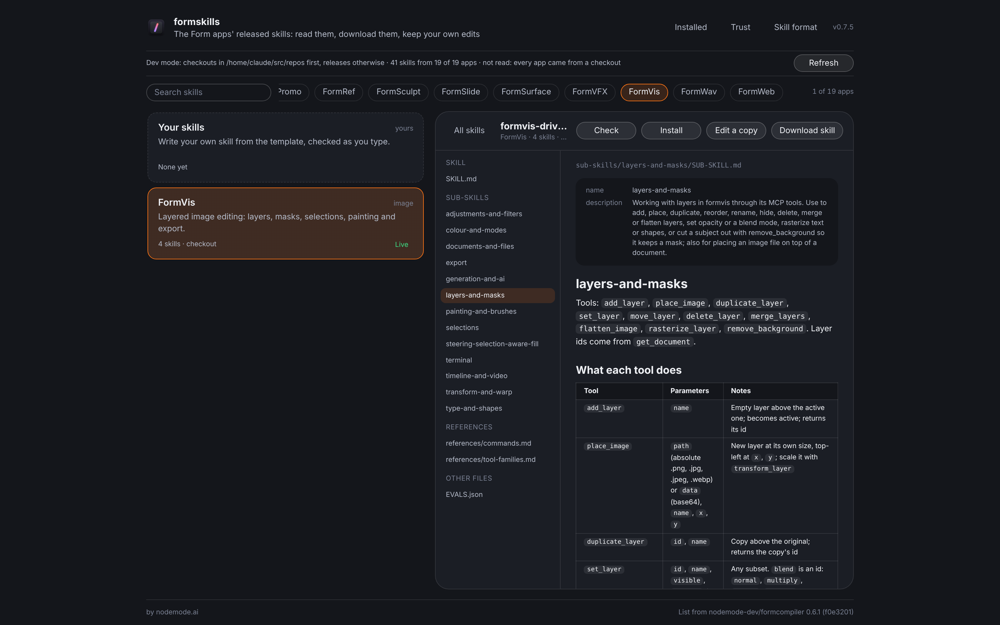
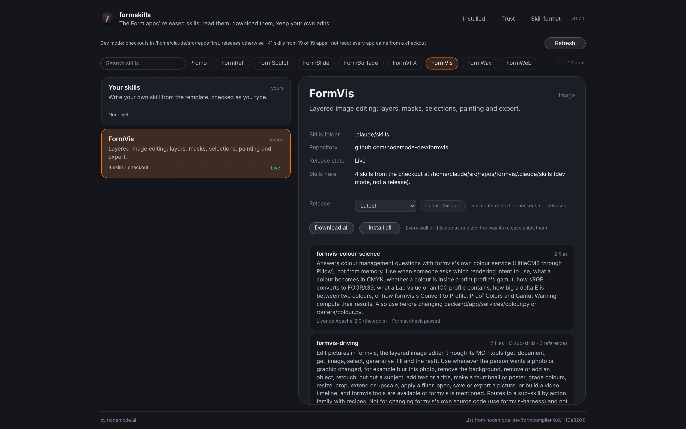
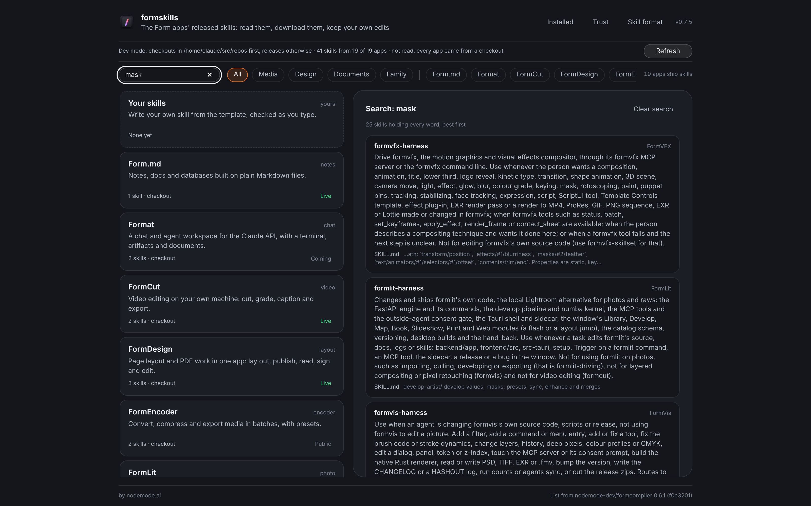
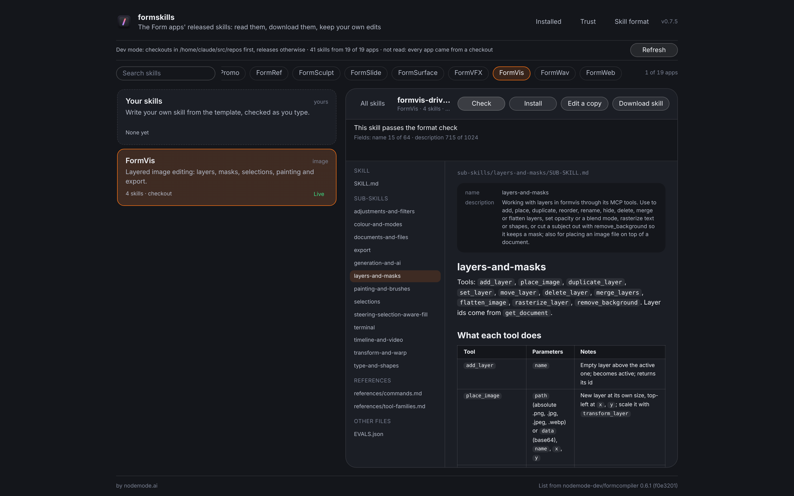
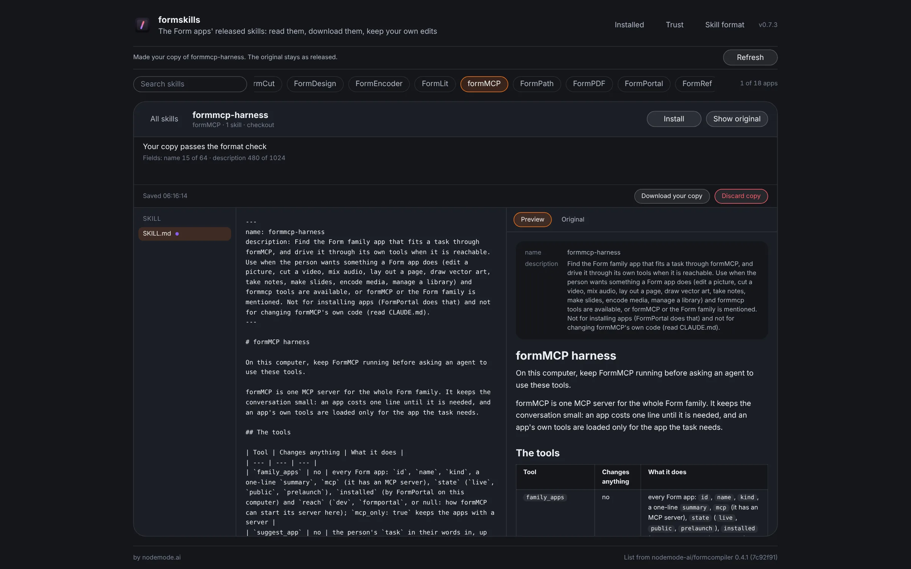

<p align="center">
  
</p>

<h1 align="center">FormSkills</h1>

<p align="center">
  <b>Agent skills; every Form app's released skills in one place.</b><br>
  Read them, download them and keep your own edited copies,<br>
  then install them into Claude Code, Codex or Cursor. Runs on your own computer.
</p>

<p align="center">
  
  
  
  
  
  
</p>

<p align="center">
  <a href="https://formskill.formai.studio/"><b>Download FormSkills on formai.studio</b></a> ·
  <a href="#run-it-from-source">Run it from source</a>
</p>

<br>

<p align="center">
  
  <br>
  <sub>A real skill open in the reader: its sub-skills and references on the left, the formatted SKILL text on the right.</sub>
</p>

<p align="center">
  <a href="#features">Features</a> ·
  <a href="#everything-in-the-box">In the box</a> ·
  <a href="#built-for-agents">Agents</a> ·
  <a href="#under-the-hood">Under the hood</a> ·
  <a href="#download">Download</a> ·
  <a href="#run-it-from-source">Run from source</a>
</p>

<br>

<table>
  <tr>
    <td width="25%" valign="top"><h3>Released only</h3>Shows what each app's latest signed release carries, with its digest checked. No unreleased work.</td>
    <td width="25%" valign="top"><h3>Your edits stay yours</h3>Edit a copy beside the read-only original. It is flagged when a new release changes the original.</td>
    <td width="25%" valign="top"><h3>Read, never run</h3>Skills are shown as text and never executed. Cards say when a skill holds scripts.</td>
    <td width="25%" valign="top"><h3>Agent-ready</h3>The same engine runs from the window and from a JSON command line, and installs skills into three agents.</td>
  </tr>
</table>

<br>

## Features

<table>
  <tr>
    <td width="50%" valign="top"><br><sub>One card per app, and every skill it shipped.</sub>
      <h3>A library of skills</h3>Chips for All, each topic and each app. Pin an app to one of its last five releases, or update one app alone.</td>
    <td width="50%" valign="top"><br><sub>Search across every app's skills by name, description or text.</sub>
      <h3>Find the right skill</h3>Results are ranked and show where the words matched. Narrow by topic or app.</td>
  </tr>
  <tr>
    <td width="50%" valign="top"><br><sub>The SKILL.md format check on a released skill.</sub>
      <h3>Checked against the format</h3>Every skill shows its licence and whether it passes the open Agent Skills format plus Claude's own rules.</td>
    <td width="50%" valign="top"><br><sub>Your copy, with a live preview and the original one click away.</sub>
      <h3>Edit a copy</h3>Saved as you type in FormSkills' own folder. Download your copy as a zip whenever you like.</td>
  </tr>
</table>

## Everything in the box

<table>
  <tr>
    <td width="33%" valign="top"><h4>19 Form apps</h4>Every Form app that ships skills, listed from formcompiler's registry</td>
    <td width="33%" valign="top"><h4>Actions</h4>Read · Search · Check · Download one or a whole set · Pin a release · Edit a copy · Write your own · Install · Update · Remove</td>
    <td width="33%" valign="top"><h4>Agents</h4>Claude Code (<code>~/.claude/skills</code>) · Codex (<code>~/.agents/skills</code>) · Cursor (<code>~/.cursor/skills</code>), for you or for one project</td>
  </tr>
</table>

## Built for agents

Every action in the window is also a `formskills-cli` command that prints JSON, run through the `./formskills cli` launcher.

```sh
./formskills cli search mask                          # every skill holding the word, best first
./formskills cli check formpdf                        # an app's skills against the SKILL.md format (exit 1 on an error)
./formskills cli read formvis formvis-harness/SKILL.md  # one file of a skill, as text
./formskills cli install formvis --to claude,codex    # every formvis skill into Claude Code and Codex
```

`./formskills cli help` lists them all. See [`AGENTS.md`](AGENTS.md).

## Under the hood

- **Engine:** `formskills-core` fetches the signed family catalogue, checks each skills asset's SHA-256, unpacks it safely and keeps it until a newer release.
- **Trust:** the catalogue is verified with the same key model as FormPortal and formMCP, and reads never leave the skills folder.
- **Shell and window:** a Tauri 2 shell around a vanilla TypeScript and Vite window with zero runtime dependencies.
- **Generated list:** the apps that ship skills come from formcompiler's registry (`./formskills apps`).
- **Tested:** 31 Rust tests (catalogue trust, digests, safe unpacking, the format checks, link resolution).

## Download

| Platform | Download | Release |
|---|---|---|
| macOS | [Download FormSkills for macOS](https://formai.studio/get/formskill/macos) | [FormSkills releases on FormCompiler](https://github.com/nodemode-dev/formcompiler/releases?q=formskills-v&expanded=true) |
| Windows | [Download FormSkills for Windows](https://formai.studio/get/formskill/windows) | [FormSkills releases on FormCompiler](https://github.com/nodemode-dev/formcompiler/releases?q=formskills-v&expanded=true) |
| Linux | [Download FormSkills for Linux](https://formai.studio/get/formskill/linux) | [FormSkills releases on FormCompiler](https://github.com/nodemode-dev/formcompiler/releases?q=formskills-v&expanded=true) |

All FormSkills builds are compiled and released from [FormCompiler](https://github.com/nodemode-dev/formcompiler); this repo holds the source.

**Updates come through FormPortal.** FormSkills updates the skills it installs, but not the app itself: install [FormPortal](https://formai.studio/formportal/) and it keeps FormSkills up to date, or download the new version from the links above.

## Run it from source

Want to contribute or try the latest code? Run it straight from this repo.

**Requires:** Rust (stable), Node 20.19+, and on Linux WebKitGTK 4.1 for the window (the installer prints the packages).

```sh
git clone git@github.com:nodemode-dev/formskills.git
cd formskills
./formskills_oc_install   # checks tools, installs the window packages, fetches the Rust crates
./formskills              # starts the interface on localhost:5630 and opens the desktop window
```

The window needs its Tauri shell to read skills; the interface alone in a browser only says so. `./formskills dev` reads Form app checkouts beside this one instead of releases.

On Windows run `formskills_oc_install.bat`, then `formskills.bat`. Ports: 5630 (Vite dev server) and 5631 (preview), localhost only.

> [!IMPORTANT]
> **Status:** early. Agents loading installed skills is taken from each agent's docs, not tried here.

**Contributing:** branch from `main`, keep changes to source here, and leave packaging and releases to formcompiler. See [`.docs/BRANCHING.md`](.docs/BRANCHING.md) and [`AGENTS.md`](AGENTS.md).

## Repository

| Path | What it is |
|---|---|
| `core/` | The engine: apps list, signed catalogue, fetching, search, format check, downloads, edits, installs |
| `cli/` | `formskills-cli`, the JSON command line |
| `src-tauri/` | The Tauri shell that opens the window |
| `frontend/` | The window: chips, cards, detail pane and reader |
| `setup/apps.py` | Generates `core/data/apps.json` from formcompiler's registry |

Docs: [`.docs/wiki`](.docs/wiki) · Agents: [`CLAUDE.md`](CLAUDE.md), [`AGENTS.md`](AGENTS.md) · Contributing: [`.docs/BRANCHING.md`](.docs/BRANCHING.md)

<br>

---

## Maintainers

| Maintainer | Role |
|---|---|
| [@nodemode-ai](https://github.com/nodemode-ai) | Owner |
| [@gbarnai](https://github.com/gbarnai) | Co-owner |

Code owners are set in [`.github/CODEOWNERS`](.github/CODEOWNERS).

## License

FormSkills is licensed under the GNU General Public License v3.0 ([`LICENSE`](LICENSE), SPDX `GPL-3.0-only`). Copyright 2026 NodeAgentc, Inc. Third-party notices: [`NOTICE.md`](NOTICE.md).

<sub>Screenshot content: the released skills of the Form apps, read from local checkouts of their repositories.</sub>

Claude Code, Codex and Cursor are named only as the agent tools the skills are written for. FormSkills is an independent project and is not affiliated with or endorsed by Anthropic, OpenAI or Anysphere.
