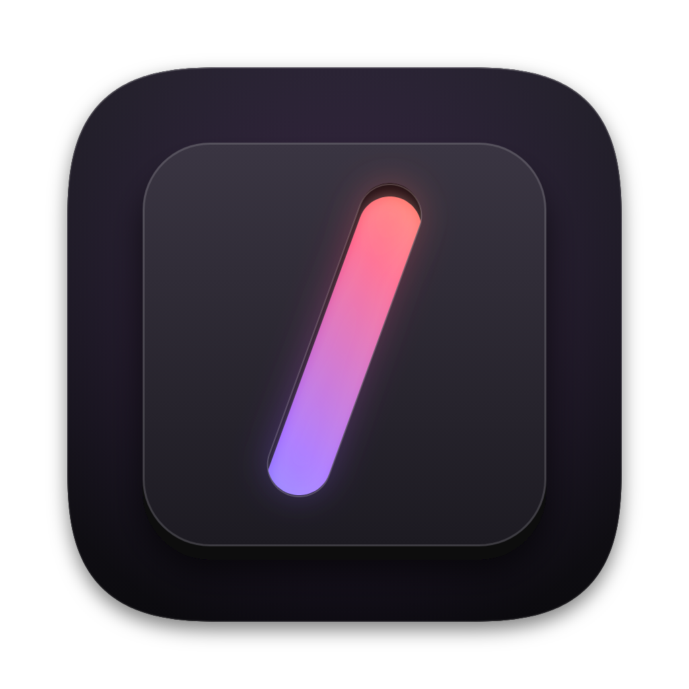

<p align="center"></p>

<h1 align="center">formskills</h1>

<p align="center"><b>Every Form app's released skills in one place: read them, download them, keep your own edited copies.</b></p>

<p align="center">
  
  
  
  
  
  
</p>

formskills is where the skills of the Form family of desktop apps (image, video, audio, layout, vector, notes, slides and the rest, by nodemode.ai) are found. Each app ships its agent skills with every release; formskills lists them by app, shows each one as formatted text with its sub-skills and references, lets you download a skill or an app's whole set, and keeps your own edited copies beside the originals. It shows exactly what shipped: no unreleased work, and nothing is ever changed in an app.

**Stack:** Rust (`formskills-core`, `formskills-cli`) · Tauri 2 shell · vanilla TypeScript + Vite window with zero runtime dependencies · **Scale:** 18 Form apps that ship skills, from formcompiler's registry

## Highlights

- **Released skills only.** What formskills shows is what each app's latest release carries: the skills asset named in the signed family catalogue, its digest checked, kept on this computer and reused until a new release changes it. No `main`, no watch step, no copy kept in this repository. A dev mode (`./formskills dev`) reads local checkouts instead, for building the apps.
- **One place for skills.** formMCP gives agents the Form apps' tools; formskills is where their skills live. The two do not overlap.
- **Your edits stay yours.** Make your own copy of any skill and edit it with a live preview and the original read-only beside it. The copy is saved as you type and kept in formskills' own folder; the original is never changed, and when a newer release changes it your copy is flagged with the files that changed. Download your copy as a zip whenever you like.
- **Never hand-kept.** The list of apps is generated from formcompiler's registry (`./formskills apps --compiler PATH`) and records the version and commit it came from.
- **Find and check.** Search every app's skills by name, description or text, and narrow by topic (Media, Design, Documents, Family) or app. Every skill shows its licence and whether it passes the SKILL.md format check (the open Agent Skills format plus Claude's own rules); Check lists each error and note, runs on your copy after every save, and the Skill format page explains the rules.
- **Your own skills.** Start one from the format's template under Your skills; it opens in the editor and is checked as you type, kept in formskills' folder, and downloads as `<name>.zip`.
- **Choose the release.** Keep an app on one of its last five releases instead of the latest, or update one app on its own.
- **Know what you are trusting.** The Trust page says what a skill can make an agent do, what formskills checks (signature, digest, safe unpacking) and what it does not, and how far to rely on skills; cards say when a skill holds scripts.
- **Read them properly.** Each app's skills as cards; open one to read its SKILL.md as formatted text, with its sub-skills, references and other files beside it and links between them followed. Skills are shown as text and never run.
- **Download what shipped.** One skill, or an app's whole set, as a zip shaped exactly like the release asset, saved to Downloads.
- **Install into your agent.** Put a skill, an app's set, your copy or your own skill into Claude Code, Codex or Cursor, for you or for one project. formskills writes only folders it made, keeps any change made there unless you choose to lose it, and its Installed page updates or removes what it put in.
- **A window that does not flicker.** Chips for All and each app, a card per app, a detail pane and reader; painted complete in its first frame, and nothing moves when the skills arrive.

## Quick start

Requirements: Rust (stable), Node 20.19+, and on Linux WebKitGTK 4.1 for the window (the installer prints the packages).

```bash
./formskills_oc_install     # macOS / Linux
./formskills                # the window on localhost:5630
./formskills cli apps       # the apps that ship skills, as JSON
./formskills cli skills formvis   # its latest released skills and where they came from
./formskills cli fetch      # download every app's latest released skills again
./formskills cli search mask                         # every skill holding the words, best first
./formskills cli check formpdf                       # its skills against the SKILL.md format (exit 1 on an error)
./formskills cli read formvis formvis-harness/SKILL.md
./formskills cli download formvis formvis-harness   # a zip in Downloads
./formskills cli edit start formvis formvis-harness # your own copy; then edit it in the window
./formskills cli edits                              # your copies, and whether their originals changed
./formskills cli new tidy-notes Tidies meeting notes   # a skill of your own from the template
./formskills cli pin formvis 1.97.1                 # keep an earlier release (latest to follow again)
./formskills cli fetch formvis                      # check and download one app again
./formskills cli install formvis --to claude,codex  # every formvis skill into Claude Code and Codex, for you
./formskills cli installed                          # what formskills installed, and whether it changed
./formskills dev            # the window, reading Form app checkouts beside this one
```

The catalogue is trusted exactly as FormPortal and formMCP trust it (`core/catalog_keys.txt` plus `FORMAI_CATALOG_PUBKEY`); until the family's key exists, formskills shows any skills it kept earlier and says why it could not read the catalogue. The wiki's Getting Started page lists every setting.

On Windows run `formskills_oc_install.bat`, then `formskills.bat`.

## Where things live

| Path | Role |
| --- | --- |
| `core/` | The engine: the list of apps that ship skills (`core/data/apps.json`, generated), the signed catalogue, fetching and keeping released skills, the skills index, search, the format check, downloads, your edited copies, installing into agents |
| `cli/` | `formskills-cli apps`, `app`, `skills`, `fetch`, `search`, `check`, `read`, `download`, `pin`, `pins`, `new`, `own`, `edits`, `edit ...`, `install`, `installed`, `update`, `uninstall`, `catalog`, `where`, `version` |
| `src-tauri/` | The shell: the window |
| `frontend/` | The window: tokens, layers, chips, cards and the detail pane |
| `setup/apps.py` | Generates `core/data/apps.json` from formcompiler's registry |
| `assets/` | The owner's icon |
| `.docs/wiki/` | Getting Started, Architecture |

| Port | Service |
| --- | --- |
| 5630 | Vite dev server (localhost only) |
| 5631 | Vite preview (localhost only) |

**Releases.** formskills builds nothing in this repository. After the version bump lands on main, push a branch `compile_vX.Y.Z` cut from that commit; CI runs on it, and formcompiler (`nodemode-ai/formcompiler`) builds the bundles with `./build_app` (`build_app.bat` on Windows) and drafts the release `formskills-vX.Y.Z` (`apps/formskills.json` in its registry). `./build_app` also builds the app on your own machine.

## Status

v0.7.0: installing into agents. Install a skill, an app's set, an edited copy or your own skill into Claude Code, Codex or Cursor, for you or one project, and update or remove it from the Installed page. Checked in a scratch home against a signed catalogue on loopback with two formvis releases: user and project installs for each agent, a foreign folder and a symlink refused, a changed install kept until forced, an install from an older pinned release updated to the newer one, copy and own-skill installs, removal; the window at 4x CPU and network throttling (CLS 0, dark 1040 by 720 and light 640 by 520) and the real app (an app's set installed into Claude Code and listed). That a running agent loads the installed folders is taken from each agent's docs, not tried here.

v0.6.0: own skills and versions. Your own skills from a template; pinning an app to an earlier release from the catalogue's history; updating one app; the Trust page and script counts. Checked against a signed catalogue on loopback with two formvis releases (pin, a pin refused when the release has no skills or is not listed, a pin the catalogue later drops, unpin, one-app update), your own skill from making to deleting, the window at 4x CPU and network throttling (CLS 0, dark, light, 640 by 480) and the real app (a skill made, kept across a restart; a release pinned through the window).

v0.5.0: find and check. A search box over every app's skills (name, description and text, matched at the start of words), topic chips, a Skill format page, each skill's licence, and a format check for released skills and your copies (`check`). Checked over the 18 checkouts in dev mode (36 skills: one real error found, formpdf-harness's description at 1,362 of 1,024 characters), the window at 4x CPU and network throttling (CLS 0, dark, light and 640 by 480) and in the real app.

v0.4.1: formskills is in formcompiler's registry (`formskills`, `ai.nodemode.formskills`) with `build_app` and `build_app.bat` for its bundles (the Linux .deb built here), under the same id and name in FormPortal, FormTray and FormRanker; formMCP's skill joins the list (18 apps).

v0.4.0: your own edited copies. A copy per skill in formskills' own folder, an editor with live preview and the read-only original beside it, saved as you type, flagged with the changed files when the original moves on, marked as seen, downloaded or discarded; the original is never written. Checked with the real engine behind the window (copy, edit, upstream change, restart, seen, download, discard; CLS 0 under 4x CPU throttling, dark, light and 640 by 480) and in the real app, quit and started again.

v0.3.1: a failed download leaves no partial file (written beside and renamed when complete; checked on a full disk).

v0.3.0: the viewer. Skill cards, a reader with the skill's files grouped as skill, sub-skills, references and other files, Markdown rendered without ever parsing HTML, links between a skill's own files followed, and downloads of a skill or an app's set shaped like the release asset. Checked: reading refuses paths and links that leave the skills folder; the formvis set downloads byte for byte like formcompiler's asset; the window at 4x CPU and network throttling through opening, reading, downloading and switching (CLS 0), and in the real app.

v0.2.0: fetch. The signed catalogue read with FormPortal's trust model; each app's latest released skills asset downloaded, its SHA-256 checked, unpacked safely and kept, reused until a new release; the kept copy shown with the reason when the network or catalogue fails; a dev mode for local checkouts; the window shows each app's skill count and source and the chosen app's skills. Checked by hand with real assets built by formcompiler and a signed catalogue on loopback (every trust, digest, unsafe-archive, upgrade and offline case), and all 17 checkouts in dev mode (35 skills); the window at 4x CPU and network throttling (CLS 0) and in the real app.

v0.1.0: the scaffold. The list of the 17 Form apps that ship skills, generated from formcompiler's registry; the command line; the window with All and per-app chips, a card per app and a detail pane, painted complete in its first frame.

Next: v0.7.0, installing skills into Claude Code, Codex and Cursor. The owner's first push, `compile_v*` branch and the family's catalogue key pair are still to come.

## License

formskills is licensed under the GNU General Public License v3.0 (`LICENSE`, SPDX `GPL-3.0-only`), as ComfyUI and formpromo are. Copyright 2026 NodeAgentc, Inc. `NOTICE.md` lists the work it includes or depends on.

## Trademarks

The names of the Form apps belong to their owner. Claude Code, Codex and Cursor are named only as the agent tools the skills are written for; formskills is not affiliated with or endorsed by Anthropic, OpenAI or Anysphere.
